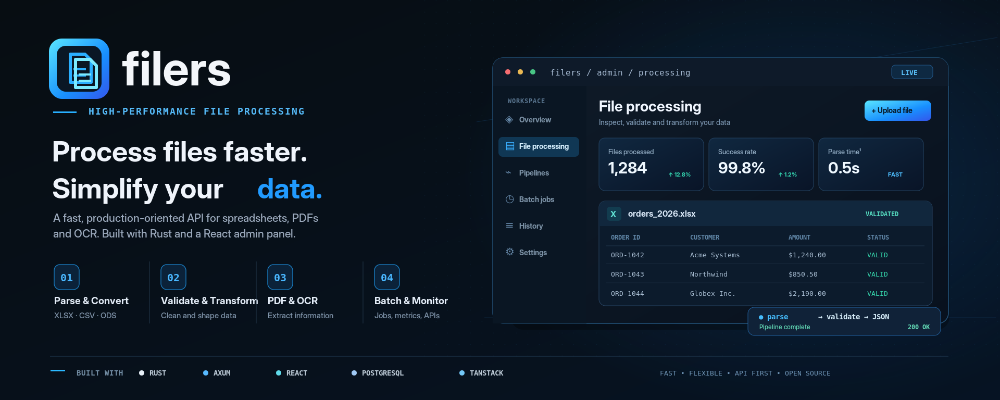

# Filers — technical documentation

Filers is a file-processing API with a React administration panel. This directory
contains implementation-oriented documentation that complements the user-facing
setup and API guide in the repository [README](../README.md).

## Documents

- [GitHub Pages landing source](index.html) — standalone static site.
- [System architecture](architecture.md) — components, boundaries, request flow,
  and persistence choices.
- [Backend](backend.md) — Rust layers, processing pipeline, APIs, and storage.
- [Frontend](frontend.md) — React application structure and API integration.
- [Operations and security](operations.md) — Docker topology, configuration,
  deployment, and operational security boundaries.

## Source of truth

These notes describe the current implementation. When behavior or configuration
changes, update the relevant document and code together. Environment variable
defaults are defined in `backend/src/config.rs` and `.env.example`; routes are
defined in `backend/src/infrastructure/http/router.rs`.

The landing page and technical documentation are published from `doc/` by
`.github/workflows/pages.yml`.
Enable **Settings → Pages → Build and deployment → GitHub Actions** in the GitHub
repository to allow the workflow to deploy. Once enabled, the project site URL
is `https://venturaproject.github.io/filers/`.
